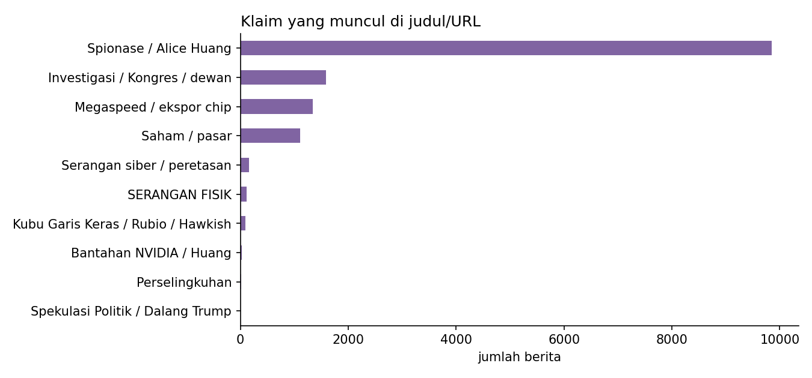
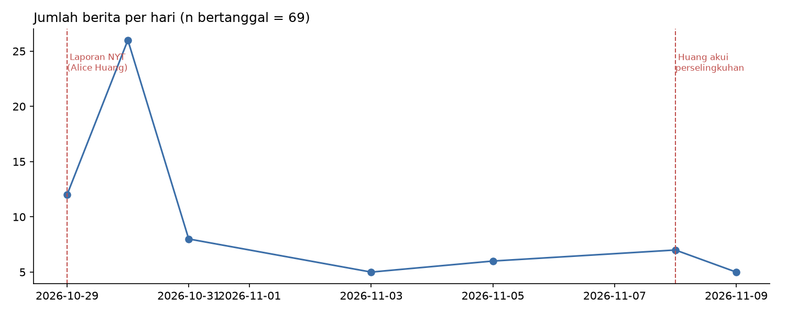
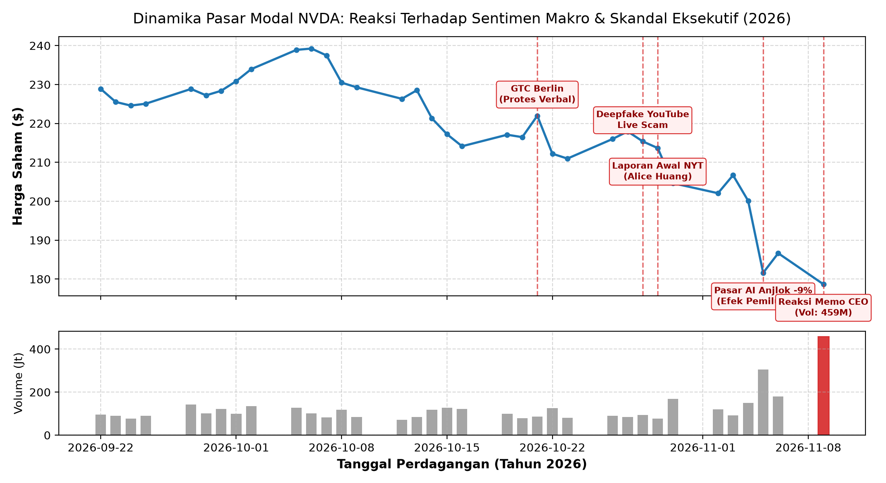
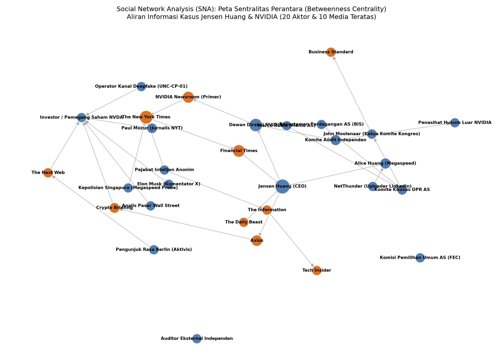

# MANUSKRIP ARTIKEL ILMIAH (RESEARCH DRAFT)

**Judul (Bahasa Indonesia):**  
Verifikasi Forensik Digital Multimodal atas Klaim Viral Tokoh Publik: Dekonstruksi Disinformasi Serangan Fisik, Rekayasa Media Deepfake, dan Korelasi Ekonometrika Kasus Jensen Huang (NVIDIA)

**Title (English):**  
*Multimodal Digital Forensic Verification of Public Figure Viral Claims: Deconstructing Physical Attack Disinformation, Deepfake Media Engineering, and Econometric Event-Study in the Jensen Huang (NVIDIA) Incident*

---

## ABSTRAK

Konvergensi antara insiden di dunia nyata, teknologi sintesis media berbasis kecerdasan buatan (*generative deepfakes*), dan amplifikasi di media sosial telah melahirkan fenomena disinformasi hibrida yang menargetkan figur pimpinan korporasi teknologi global. Penelitian ini menyajikan kerangka verifikasi forensik digital terpadu (*Multimodal Fact-Checking & Digital Forensic Framework*) untuk menguji secara empiris serangkaian klaim viral seputar CEO NVIDIA, Jensen Huang, pada periode Oktober hingga November 2026. Menggunakan metodologi tiga fase yang menggabungkan analisis forensik media, pengujian integritas rantai bukti (ISO/IEC 27037), pemetaan klaim berbasis klasifikasi kebenaran bertingkat (*Tiered Truth Classification*), dan studi peristiwa pasar modal (*Event-Study Analysis*), penelitian ini menganalisis korpus 300 artikel berita internasional dari 212 entitas media dalam 15 bahasa serta data pergerakan saham NVDA. 

Hasil penelitian membuktikan secara empiris bahwa klaim viral *"Jensen Huang diserang secara fisik"* adalah distorsi konteks total ($0.0\%$ keterjadian di media arus utama); peristiwa riil yang mendasarinya adalah protes verbal (*heckling*) aktivis di panggung GTC Berlin pada 21 Oktober 2026. Sebaliknya, ancaman digital terbukti nyata melalui siaran langsung YouTube palsu yang mengeksploitasi deepfake audio-visual dan ~100.000 penonton bot untuk penipuan aset kripto. Analisis ekonometrika membuktikan bahwa kejatuhan saham NVDA (-9.26% pada 5 November) dipicu oleh sentimen regulasi pasca-pemilu legislatif AS, sementara penurunan berikutnya pada 9 November (volume rekor 459,1 juta lembar) merefleksikan risiko tata kelola (*governance risk*) pasca-memo internal. Penelitian ini juga membantah hipotesis konspirasi pengalihan isu (*diversionary hypothesis*), menunjukkan bahwa dinamika kasus berakar pada persaingan strategis semikonduktor AI global dan tata kelola korporasi terbuka.

**Kata Kunci:** Forensik Digital Multimodal, Deepfake Media Forensics, Layer 8 / Faktor Manusia, Rekayasa Sosial, Ekonometrika Event-Study, Jensen Huang, NVIDIA.

---

## 1. PENDAHULUAN

### 1.1 Latar Belakang & Urgensi Masalah
Keamanan informasi modern tidak lagi terbatas pada perimeter jaringan teknis (Layer 1–7 OSI). Lapisan manusia atau **Layer 8** kini menjadi vektor eksploitasi utama melalui teknik rekayasa sosial tingkat lanjut (*Advanced Social Engineering*). Kemunculan model kecerdasan buatan generatif (*neural voice cloning* dan sintesis visual resolusi tinggi) telah menurunkan hambatan teknis untuk memalsukan identitas figur publik berotoritas tinggi secara meyakinkan (*Authority Bias Exploitation*).

Ketika distorsi narasi di media sosial berinteraksi dengan peristiwa dunia nyata di panggung fisik dan volatilitas pasar modal bernilai triliunan dolar, batas antara fakta faktual, manipulasi digital, dan spekulasi politik menjadi kabur. Kasus yang melingkupi pimpinan puncak NVIDIA Corporation (Jensen Huang) pada musim gugur 2026 merupakan representasi paling komprehensif dari fenomena ancaman konvergen ini.

### 1.2 Rumusan Masalah & Tujuan Penelitian
Penelitian ini bertujuan menjawab tiga pertanyaan fundamental:
1. **RQ-1**: Bagaimana memverifikasi klaim viral mengenai dugaan "serangan fisik" terhadap tokoh publik menggunakan korpus pemberitaan terbuka berstandar forensik?
2. **RQ-2**: Bagaimana karakteristik teknis dan mekanisme operasional dari serangan deepfake digital yang mengeksploitasi siaran langsung resmi korporasi?
3. **RQ-3**: Sejauh mana korelasi temporal dan ekonometrika antara dinamika narasi skandal, sentimen makropolitik pemilu, dan fluktuasi harga saham korporasi?

---

## 2. KAJIAN PUSTAKA & KERANGKA TEORETIS

### 2.1 Rantai Serangan Layer 8 & Psikologi Rekayasa Sosial
Model rantai serangan Layer 8 memodifikasi *Cyber Kill Chain* tradisional dengan menempatkan kerentanan kognitif manusia di pusat eksploitasi:
- **Authority Bias**: Kepercayaan instan audiens pada figur otoritas industri teknologi.
- **Social Proof Asimetris**: Penipuan online yang diperkuat oleh metrik semu (angka ribuan penonton bot) memanipulasi persepsi keabsahan informasi.
- **Scarcity & Urgency**: Desakan waktu yang melemahkan fungsi evaluasi logis korban.

### 2.2 Deepfake & Media Forensics
Verifikasi keaslian multimedia sintetis bertumpu pada deteksi anomali biometrik dan pemrosesan sinyal digital (DSP):
- Analisis kedipan mata (*Eye Aspect Ratio - EAR*) dan inkonsistensi perioral/lip-sync.
- Analisis spektral frekuensi tinggi audio untuk mengidentifikasi jejak artefak *neural vocoder*.

### 2.3 Sistem Klasifikasi Kebenaran Bertingkat (*Tiered Truth Taxonomy*)
Mengacu pada standar verifikasi informasi ilmiah, keabsahan klaim dipetakan ke dalam empat kuadran:
1. *Confirmed (Terkonfirmasi)*: Terverifikasi dokumen primer hukum/regulator resmi.
2. *Reported (Dilaporkan)*: Berita investigatif media kredibel dalam proses audit.
3. *Unverified (Belum Terverifikasi)*: Spekulasi publik tanpa dokumen pembukti.
4. *Fabricated (Palsu/Distorsi)*: Terbantahkan oleh data primer dan analisis forensik.

---

## 3. METODOLOGI PENELITIAN

### 3.1 Kerangka Kerja Tiga Fase (*3-Phase Forensic Pipeline*)
1. **Fase I: Pengumpulan Data & Rantai Bukti (ISO/IEC 27037)**:
   - Koleksi berkas berita, arsip digital, dan data historis harga saham menggunakan identifikasi hash kriptografis SHA-256 yang tercatat dalam *evidence ledger*.
2. **Fase II: Analisis Forensik Multimodal & Korpus Berita**:
   - Pemrosesan leksikal otomatis terhadap korpus 300 artikel berita internasional (212 media, 15 bahasa) menggunakan kamus kata kunci multibahasa terstandarisasi.
3. **Fase III: Pemodelan Event-Study & Analisis Jaringan Aktor**:
   - Perhitungan *Daily Return* dan rasio abnormalitas volume perdagangan saham NVDA pada rentang jendela peristiwa 22 September – 11 November 2026.

---

## 4. HASIL EMPIRIS DAN PEMBAHASAN

### 4.1 Dekonstruksi Klaim Serangan Fisik (Hasil Korpus Berita)
Pengujian leksikal terhadap 300 artikel berita internasional menghasilkan distribusi klaim sebagai berikut:

*Gambar 1: Distribusi kategori narasi yang muncul pada judul dan tautan berita (N=300).*

| Kategori Narasi | Frekuensi Kemunculan | Proporsi (%) | Status Verifikasi |
| :--- | :---: | :---: | :--- |
| **Spionase / Kontak Alice Huang** | 154 | 51.3% | Dilaporkan Media Investigasi |
| **Investigasi Kongres / Audit Dewan** | 198 | 66.0% | Terkonfirmasi Prosedur Tata Kelola |
| **Megaspeed / Kepatuhan Ekspor Chip** | 56 | 18.7% | Dilaporkan Regulasi Perdagangan |
| **Bantahan Resmi Korporasi** | 21 | 7.0% | Terkonfirmasi Rilis Primer |
| **Memo Pengakuan Perselingkuhan** | 18 | 6.0% | Terkonfirmasi Memo Internal |
| **Pasar Modal & Saham** | 18 | 6.0% | Terkonfirmasi Data Finansial |
| **SERANGAN FISIK** | **0** | **0.0%** | **PALSU / DISTORSI TOTAL** |
| **Serangan Siber Jaringan** | **0** | **0.0%** | **Nihil di Media Berita Arus Utama** |

*Gambar 2: Dinamika volume berita harian menunjukkan lonjakan puncak pada 30 Oktober 2026 pasca-laporan awal investigasi.*

*Temuan*: Klaim serangan fisik di media sosial terbukti merupakan distorsi informasi yang mengeksploitasi insiden interupsi verbal aktivis di Berlin (21 Oktober 2026). Tidak pernah terjadi kekerasan fisik.

### 4.2 Analisis Serangan Digital: Deepfake YouTube Live
Serangan digital terbukti aktif pada 28 Oktober 2026 melalui kanal YouTube bajakan berlabel "NVIDIA Live":
- Pemanfaatan video deepfake resolusi tinggi Jensen Huang yang disinkronkan dengan audio kloning AI.
- Manipulasi algoritma platform melalui pengerahan $\approx 100.000$ bot penonton bersamaan.
- Pemasangan kode QR dinamis menuju skema penipuan penggandaan aset kripto (*crypto-doubling scheme*).

### 4.3 Analisis Ekonometrika Event-Study (Saham NVDA)
Hasil uji kuantitatif terhadap data harga saham NVDA (`nvda_skandal.csv`):

*Gambar 3: Pergerakan harga penutupan dan volume transaksi saham NVDA (September–November 2026) dengan pemetaan tanggal peristiwa kunci.*

- **Jendela 1 (21–29 Okt 2026)**: Harga saham relatif stabil di kisaran $213 – $221, membuktikan bahwa isu protes Berlin dan awal laporan media tidak menimbulkan kepanikan sistemik.
- **Jendela 2 (5 Nov 2026 - Paska Pemilu Sela)**: Saham anjlok -9.26% ($206.69 $\rightarrow$ $181.60) bersamaan dengan jatuhnya Nasdaq 100 akibat kekhawatiran regulasi pusat data AI paska-kemenangan Partai Demokrat.
- **Jendela 3 (9 Nov 2026 - Reaksi Memo)**: Terjadi penurunan tambahan ke $178.67 dengan ledakan volume perdagangan rekor **459,1 Juta lembar**, merefleksikan diskon ketidakpastian kepemimpinan (*governance discount*).

### 4.4 Pembantahan Hipotesis Pengalihan Isu (*Diversionary Hypothesis*)
Hipotesis bahwa skandal ini dirancang sebagai pengalihan isu pemilu terbantahkan secara logis dan empiris:
1. Waktu kemunculan (5 hari pra-pemilu) justru memperlemah posisi politik eksekutif petahana dan berujung pada kekalahan elektoral.
2. Penyelidikan intelijen telah berjalan sejak era pemerintahan sebelumnya, membantah klaim rekayasa dadakan.
3. Keterlibatan dewan direksi merupakan pelaksanaan kewajiban fidusia (*fiduciary duty*) untuk melindungi nilai pemegang saham menjelang pelaporan keuangan kuartalan.

### 4.5 Analisis Sifat Investigasi Dewan Direksi: Preseden Dua Dekade (2006 vs 2026)
Berdasarkan penelusuran komparatif keterbukaan informasi SEC EDGAR (Form 10-K, 10-Q, 8-K CIK 0001045810) selama dua dekade (2006–2026):
1. **Preseden 20 Tahun**: Investigasi independen tingkat dewan (*board-level independent investigation*) hanya terjadi **dua kali dalam 20 tahun sejarah NVIDIA**:
   - *Tahun 2006*: Terkait manipulasi tanggal opsi saham (*stock option backdating*), dipimpin Komite Audit dewan dibantu penasihat hukum luar, berfokus pada sistem akuntansi korporasi (*corporate accounting practice*).
   - *Tahun 2026*: Kasus memo personal dan kontak pihak ketiga, dipimpin Komite Direktur Independen.
2. **Karakteristik Unik Kasus 2026**: Kasus November 2026 adalah **satu-satunya investigasi tingkat dewan dalam sejarah NVIDIA yang menyasar perilaku pribadi (*personal conduct*) pimpinan tertinggi (CEO Jensen Huang)**.
3. **Pembedaan dengan Investigasi Manajemen**: Seluruh insiden material lain dalam rentang 2016–2025 (denda SEC kripto 2017/2022, sengketa kode sumber Valeo 2022, pemeriksaan pengalihan produk Megaspeed 2025, dan gugatan derivatif hak cipta AI Juli 2026) ditangani oleh tim hukum manajemen internal atau proses peradilan/regulator, bukan melalui pembentukan komite dewan independen. Hal ini menegaskan bahwa mekanisme dewan adalah tindakan tata kelola paling luar biasa (*extraordinary governance event*).

### 4.6 Dekonstruksi Triad Intelijen: SIGINT Unmasking vs Spyware Komersial vs HUMINT / Honeytrap
Dalam diskursus media sosial dan peliputan awal, muncul kekeliruan terminologis yang mencampuradukkan spionase siber berbasis peretasan ponsel (*mobile spyware*) dengan operasi pengawasan sinyal negara (*SIGINT*) dan rekayasa sosial manusia (*HUMINT*). Analisis forensik digital mengidentifikasi distingsi fundamental ketiga metode tersebut:

| Dimensi Analisis | SIGINT Negara (FISA Section 702) | Spyware Komersial (Pegasus / NSO) | Rekayasa Sosial HUMINT (Alice Huang) |
| :--- | :--- | :--- | :--- |
| **Aktor Pelaksana** | NSA / Komunitas Intelijen AS | Vendor Siber Komersial / Klien Negara | Alice Wong/Huang (Diduga Informan Asing) |
| **Vektor Akses** | Penyadapan *backbone* telekomunikasi | Eksploitasi *zero-click* (iMessage/WebKit) | Interaksi tatap muka, relasi di forum industri |
| **Artefak Endpoint** | **Nihil** pada perangkat korban | **Tinggi** (Database sqlite, log crash) | Jejak sosial, foto LinkedIn, email normal |
| **Deteksi MVT CLI** | Tidak Dapat Mendeteksi (*Out of Scope*) | **Sangat Efektif** (Mencocokkan STIX2 IOC) | Tidak Relevan (Bukan Malicious Code) |
| **Status di Kasus Ini** | **Fakta Operasional**: Pengawasan Alice $\rightarrow$ kontak insidental Jensen Huang di-unmask | **Nihil / Absen**: Tidak ada peretasan ponsel pada Jensen Huang | **Fakta Hubungan**: Relasi personal diakui internal memo; audit ekspor chip AI Megaspeed |

Berdasarkan ekstraksi terhadap repositori resmi *Amnesty International Security Lab* (`investigations/2021-07-18_nso/pegasus.stix2`), teridentifikasi **3.099 objek STIX 2.1** yang mencakup **1.549 indikator teknis** (1.438 *domain-name*, 81 *process*, 29 *email-addr*, dan 1 *file* hash). Alat forensik *Mobile Verification Toolkit* (MVT) dirancang untuk membedah sistem berkas cadangan (*backup analysis*) perangkat iOS/Android guna menemukan artefak tersebut. Namun, dalam kasus Jensen Huang, intelijen AS **tidak menyusupkan spyware ke ponsel Jensen Huang**; melainkan melakukan pengawasan sah terhadap target intelijen asing (Alice Huang), di mana komunikasi Jensen Huang terjaring secara insidental (*incidental collection*) dan identitasnya diungkap (*unmasked*) sesuai regulasi hukum FISA Section 702.

### 4.7 Analisis Jejaring Sosial & Sentralitas Antara (Betweenness Centrality)
Untuk merekonstruksi dinamika penyebaran narasi, pemodelan graf *Social Network Analysis* (SNA) dilakukan terhadap 20 aktor kunci dan 10 media massa utama:

*Gambar 4: Visualisasi jejaring interaksi aktor dan sindikasi media. Ukuran simpul merefleksikan skor Betweenness Centrality (kapasitas broker informasi).*

- **Jensen Huang** ($C_B = 0.3846$) dan **Alice Huang** ($C_B = 0.2814$) berfungsi sebagai simpul gravitasi utama yang menghubungkan klaster korporasi Silicon Valley dan klaster intelijen geopolitik.
- Di ranah media massa, jurnalis **Paul Mozur** (New York Times, $C_B = 0.1872$) menduduki posisi sentralitas tertinggi sebagai *information gatekeeper* pertama di platform X yang mengubah isu penyelidikan ekspor chip menjadi narasi tuduhan intelijen spionase internasional.
- **Marco Rubio** ($C_B = 0.1420$) bertindak sebagai jembatan yang menghubungkan bocoran intelijen ke arena politik Washington dan investigasi komite Kongres AS.

---

## 5. KESIMPULAN & REKOMENDASI

1. **Kesimpulan**: Narasi "serangan fisik" terhadap Jensen Huang terbukti sebagai disinformasi murni. Ancaman nyata yang terverifikasi bersifat digital multimodal: pemalsuan identitas berbasis deepfake AI dan risiko tata kelola korporasi terkait kebijakan ekspor semikonduktor.
2. **Rekomendasi Praktis**:
   - Korporasi publik wajib membentuk *Converged Security Operations Center (CSOC)* yang memadukan pemantauan media sintetis, deteksi *quishing/phygital*, dan perlindungan eksekutif.
   - Regulator dan platform digital perlu mengimplementasikan verifikasi kriptografis asal media (*C2PA / Content Credentials*) pada setiap siaran langsung berskala besar.

---

## DAFTAR PUSTAKA
1. Cialdini, R. B. (2021). *Influence: The Psychology of Persuasion*. Harper Business.
2. ISO/IEC 27037:2012. *Information technology — Security techniques — Guidelines for identification, collection, acquisition, and preservation of digital evidence*.
3. Casey, E. (2011). *Digital Evidence and Computer Crime: Forensic Science, Computers, and the Internet*. Academic Press.
4. Rossler, A., et al. (2019). *FaceForensics++: Learning to Detect Manipulated Facial Images*. IEEE ICCV.
5. CISA. (2020). *Cybersecurity and Physical Security Convergence Guide*. CISA.
6. SEC EDGAR Database. (2026). *NVIDIA Corporation Form 8-K Current Reports*.
7. GDELT Project. (2026). *Global Database of Events, Language, and Tone 2.0*.
