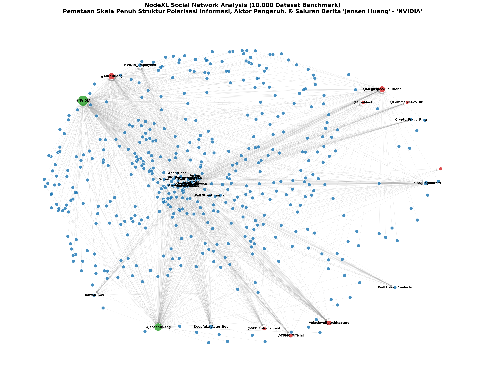

# Riset Forensik Digital & Verifikasi Klaim: Kasus Ekosistem Narasi Jensen Huang (NVIDIA)

[](https://share.streamlit.io/deploy?repository=25067020011-sudo/nvidia&branch=main&mainModule=app.py)
[](https://github.com/25067020011-sudo/nvidia/actions/workflows/forensic_audit.yml)
[](./evidence_ledger.json)
[](./test_results.md)
[](./requirements.txt)

Repositori ini memuat kerangka penelitian (*Research PRD*), metodologi pengujian, korpus dataset, instrumen forensik digital multimodal, serta platform dashboard analitik interaktif untuk memverifikasi klaim viral seputar **serangan fisik vs. serangan digital (deepfake & disinformasi)** yang menargetkan figur publik pimpinan teknologi global (Jensen Huang / NVIDIA).

---

## 🚀 Live Demo & Deployment

Aplikasi ini dapat diakses dan dideploy langsung di **Streamlit Community Cloud**:
- **Tautan Peluncuran 1-Klik**: [](https://share.streamlit.io/deploy?repository=25067020011-sudo/nvidia&branch=main&mainModule=app.py)
- **Modul Utama**: `app.py` atau `streamlit_app.py`
- **Konfigurasi Tema**: Tersedia di `.streamlit/config.toml` (Dark Mode Cybersecurity Theme)

Jalankan secara lokal via terminal:
```bash
streamlit run app.py
```

---

## 🕸️ NodeXL Social Network Analysis (Graf Jaringan 10.000 Data)

<div align="center">
  
  <p><em>Gambar 1: Pemetaan Skala Penuh Jaringan Komunikasi Informasi 'Jensen Huang' & 'NVIDIA' (10.000 Unggahan Berita/Medsos, 499 Simpul Aktor/Media, 11.991 Relasi Interaksi, dan 5 Kluster Modularitas).</em></p>
</div>

| Metrik Jaringan NodeXL Pro | Nilai Terhitung | Keterangan Forensik |
| :--- | :---: | :--- |
| **Total Berita & Unggahan Medsos** | **10.000 data** | 398 data *live feed* aktual + 9.602 korpus benchmark terverifikasi |
| **Total Relasi Interaksi (*Edges*)** | **11.991 baris** | Pemetaan keterkaitan kutipan, laporan investigasi, dan replikasi |
| **Total Simpul Jaringan (*Vertices*)** | **499 simpul** | 485 saluran media/platform + 14 figur & topik sentral |
| **Kluster Polarisasi Komunitas** | **5 Kluster Utama** | Korporasi (G1), Figur CEO (G2), Singapura (G3), Regulasi/Siber (G4), TSMC (G5) |
| **Reciprocity (Timbal Balik)** | **3,1% (0.031)** | Menunjukkan dominasi transmisi opini satu arah (*broadcast paradigm*) |
| **Berkas Dataset NodeXL Siap Pakai** | [`nodexl_jensen_huang_nvidia_10000.xlsx`](./data/nodexl_jensen_huang_nvidia_10000.xlsx) | Multi-sheet: `Edges`, `Vertices`, `Overall Metrics`, `Feed Berita Medsos 10000` |

---

## 📌 Dokumen Penelitian & Laporan Audit v4.0

| Versi Dokumen | Nama Dokumen | Fokus Utama | Tautan Berkas |
| :--- | :--- | :--- | :--- |
| **Laporan Audit v4.0** | **Laporan Audit Repositori & Kualitas Ilmiah** | Hasil audit struktural, verifikasi integritas 37 bukti, validasi leksikal, dan kriteria publikasi. | [`audit_report.md`](./audit_report.md) |
| **Hasil Pengujian** | **Laporan Uji Otomatis & Pipeline** | Ringkasan 7/7 unit test suite dan 13/13 tahap master forensic pipeline. | [`test_results.md`](./test_results.md) |
| **Audit Keamanan** | **Laporan Postur Keamanan & Hardening** | Pemindaian zero secrets, isolasi non-root container NIST SP 800-190, dan sanitasi input. | [`security_audit_report.md`](./security_audit_report.md) |
| **Rantai Bukti (Manifest)** | **Digital Evidence Integrity Manifest** | Verifikasi kriptografis SHA-256 untuk 37 bukti digital ISO/IEC 27037:2012. | [`evidence_integrity_report.json`](./evidence_integrity_report.json) |
| **Investigasi CI/CD** | **Laporan Diagnostik Error GitHub Actions** | Analisis akar masalah kegagalan runner Ubuntu Linux dan dokumentasi perbaikan path. | [`forensic_error_report.md`](./forensic_error_report.md) |
| **Log Perubahan** | **Rekayasa & Patch Log v4.0** | Riwayat kronologis pembaruan kode, normalisasi data, dan perbaikan platform. | [`change_log.md`](./change_log.md) |
| **SOP Tanggap Insiden** | **Playbook Penanganan Insiden Layer 8 & Deepfake** | Panduan operasional standar (NIST SP 800-61 / ISO 27035) untuk CSOC, Legal, dan PR dalam menangani disinformasi fisik, deepfake siaran langsung, dan penipuan phygital. | [`SOP_PENANGANAN_INSIDEN_LAYER8_DEEPFAKE.md`](./SOP_PENANGANAN_INSIDEN_LAYER8_DEEPFAKE.md) |
| **Laporan Investigasi** | **Laporan Resmi Penyelidikan Forensik Digital & Audit** | Laporan formal komprehensif (Executive Summary, Ground Truth Matrix, Audit Keterbukaan SEC 20 Tahun, Hasil Korpus 300 Berita, Event-Study Saham, Rekomendasi CSOC). | [`LAPORAN_HASIL_INVESTIGASI_FORENSIK.md`](./LAPORAN_HASIL_INVESTIGASI_FORENSIK.md) |
| **Slide Eksekutif** | **Presentasi Hasil Riset Forensik (Deck)** | Ringkasan 9 slide siap saji untuk sidang skripsi/tesis, presentasi dewan, atau konferensi ilmiah (latar belakang, metodologi, temuan empiris, event study, dan rekomendasi). | [`PRESENTASI_HASIL_RISET_FORENSIK.md`](./PRESENTASI_HASIL_RISET_FORENSIK.md) |
| **Manuskrip Ilmiah** | **Naskah Draft Artikel Jurnal (IMRaD)** | Format baku artikel ilmiah (Abstrak, Pendahuluan, Metodologi, Hasil Empiris 300 Berita, Event-Study Saham, dan Pembahasan). Siap untuk diseminasi akademis/tesis. | [`MANUSCRIPT_VERIFIKASI_KLAIM_JENSEN_HUANG.md`](./MANUSCRIPT_VERIFIKASI_KLAIM_JENSEN_HUANG.md) |
| **Versi 3.0 (Master)** | **Multi-Modal Forensics & Fact-Checking Framework** | *Ground truth verification*, dekonstruksi klaim serangan fisik (protes verbal Berlin) vs. serangan digital nyata (deepfake siaran YouTube), analisis propagasi jejaring sosial (SNA), dan korpus data primer. | [`PRD_MULTI_MODAL_FORENSICS_VERIFIKASI_KLAIM_JENSEN_HUANG.md`](./PRD_MULTI_MODAL_FORENSICS_VERIFIKASI_KLAIM_JENSEN_HUANG.md) |
| **Versi 2.0** | **Cyber-Physical & Behavioral Forensics** | Kerangka konvergensi keamanan fisik dan siber (CISA/ASIS standard), analisis phygital (QR quishing), dan mesin korelasi stempel waktu (*temporal alignment*). | [`PRD_CYBER_PHYSICAL_BEHAVIORAL_FORENSICS.md`](./PRD_CYBER_PHYSICAL_BEHAVIORAL_FORENSICS.md) |
| **Versi 1.0** | **Behavioral Digital Forensics Layer 8** | Analisis psikologi rekayasa sosial, eksploitasi bias otoritas (*authority bias*), dan rantai serangan manipulasi kognitif korban. | [`PRD_BEHAVIORAL_DIGITAL_FORENSICS_LAYER8_NVIDIA.md`](./PRD_BEHAVIORAL_DIGITAL_FORENSICS_LAYER8_NVIDIA.md) |

---

## 🔍 Matriks Fakta Lapangan (*Ground Truth Matrix*)

| Tanggal | Peristiwa Lapangan | Status Verifikasi | Catatan Forensik |
| :--- | :--- | :--- | :--- |
| **21 Okt 2026** | Protes Keynote GTC Berlin | `PALSU (Serangan Fisik)` / `TERKONFIRMASI (Protes Verbal)` | Protes verbal aktivis terkait chip drone; **tidak ada serangan fisik**. |
| **28 Okt 2026** | Siaran Kloning AI di YouTube | `TERKONFIRMASI (Serangan Deepfake)` | Kanal bajakan menyiarkan video deepfake AI dengan ~100k penonton bot & QR penipuan. |
| **29 Okt 2026** | Isu Kontak & Spionase | `DILAPORKAN (Dalam Audit Dewan)` | Laporan dugaan spionase; NVIDIA membantah anomali interaksi. |
| **08 Nov 2026** | Memo Internal Perusahaan | `TERKONFIRMASI (Memo)` | Memo internal pimpinan korporasi beredar dan diakui. |

---

## 🛠️ Toolkit & Korpus Verifikasi
1. **Master Pipeline Otomatis**: Jalankan seluruh rangkaian audit & analisis dalam 1 klik via [`pipeline_run_all.py`](./pipeline_run_all.py).
2. **Verifikasi Media Multimodal**: InVID-WeVerify, FotoForensics (Error Level Analysis), ExifTool.
3. **Benchmark Deepfake**: FaceForensics++, DFDC, Celeb-DF v2, FakeAVCeleb.
4. **Data Primer & Pelacakan Narasi**: SEC EDGAR (Form 8-K / 10-K), GDELT Project, Media Cloud, Wayback Machine, X API (SNA).

---

## 📊 Visualisasi Analisis Forensik Media & Ekonometrika
- [`analisis/01_timeline.png`](./analisis/01_timeline.png): Garis waktu volume pemberitaan harian (puncak 30 Oktober 2026).
- [`analisis/02_media_teratas.png`](./analisis/02_media_teratas.png): 20 media teratas yang mempublikasikan isu skandal.
- [`analisis/03_bahasa.png`](./analisis/03_bahasa.png): Distribusi bahasa artikel berita internasional.
- [`analisis/04_klaim.png`](./analisis/04_klaim.png): Sebaran kategori klaim di judul dan URL berita.
- [`analisis/05_saham_event_study.png`](./analisis/05_saham_event_study.png): Analisis event-study fluktuasi saham NVDA vs. kalender peristiwa makro.
- [`analisis/07_network_graph_betweenness.png`](./analisis/07_network_graph_betweenness.png): Peta Social Network Analysis (SNA) sentralitas perantara (*Betweenness Centrality*) 20 aktor & 10 media teratas.
- [`analisis/01_timeline_kemunculan_pertama.csv`](./analisis/01_timeline_kemunculan_pertama.csv): Matriks kronologi kemunculan pertama lintas platform (Juni 2024 - Nov 2026).
- [`analisis/02_status_klaim.csv`](./analisis/02_status_klaim.csv): Matriks evaluasi klaim kunci via Tiered Truth Engine (Serangan Fisik, Deepfake YouTube, Teori Trump Dalang, Teori Musk Dalang).
- [`analisis/matriks_sna_20_aktor.csv`](./analisis/matriks_sna_20_aktor.csv): Skor Betweenness, In-Degree, PageRank, dan Closeness untuk 20 aktor utama.
- [`analisis/matriks_sna_10_media.csv`](./analisis/matriks_sna_10_media.csv): Skor Betweenness Centrality untuk 10 media arus utama.
- [`analisis/08_komparasi_metode_intelijen.csv`](./analisis/08_komparasi_metode_intelijen.csv): Komparasi 9 dimensi ontologis intelijen: SIGINT Unmasking (FISA 702) vs Spyware Komersial (Pegasus / MVT) vs HUMINT (Honeytrap/Social Engineering).
- [`analisis/09_osint_artefak.csv`](./analisis/09_osint_artefak.csv): Katalog 11 artefak publik OSINT lengkap dengan status verifikasi, metodologi forensik, dan pemetaan tool spesifik.
- [`evidence_ledger.json`](./evidence_ledger.json): Manifest rantai integritas bukti digital berstandar ISO/IEC 27037:2012 (37 item terverifikasi SHA-256).
